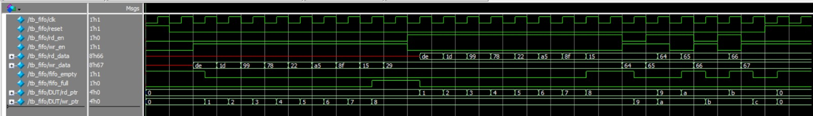
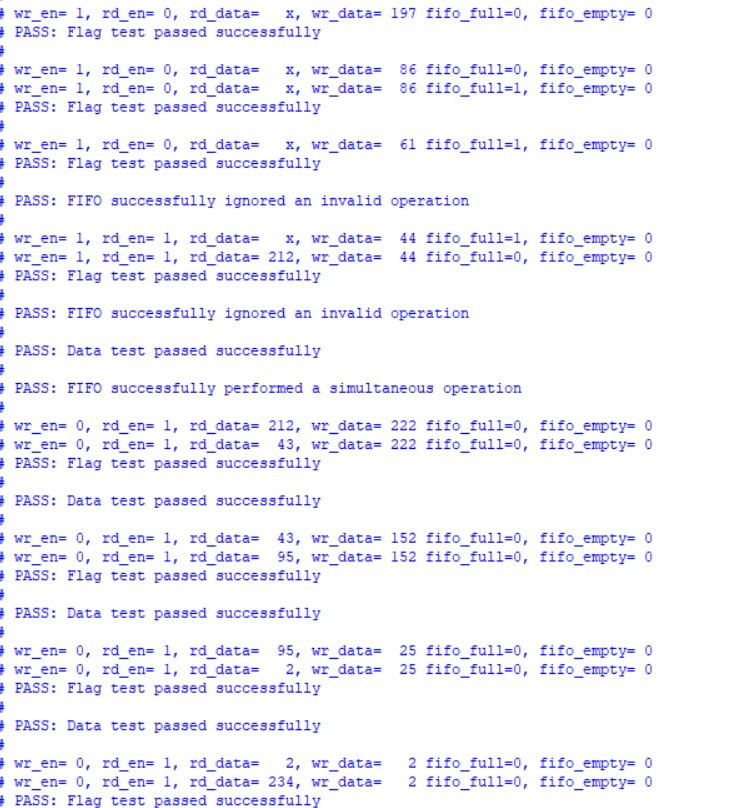
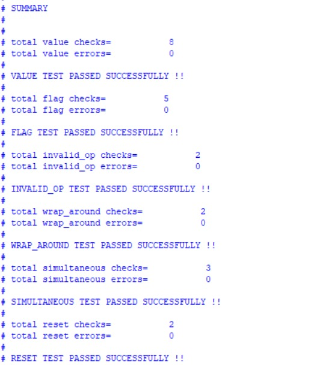
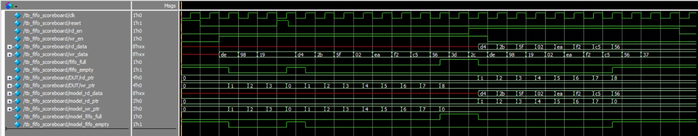
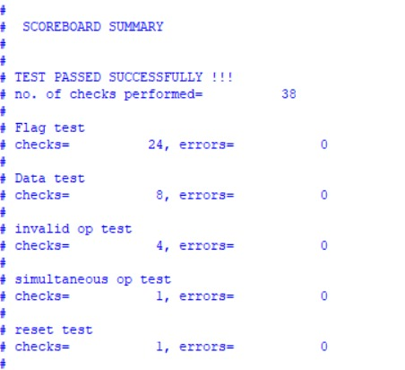
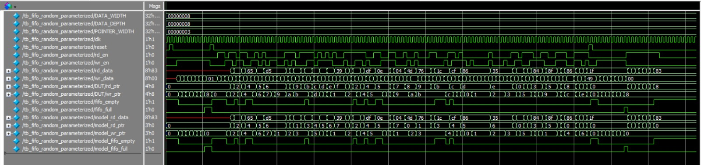
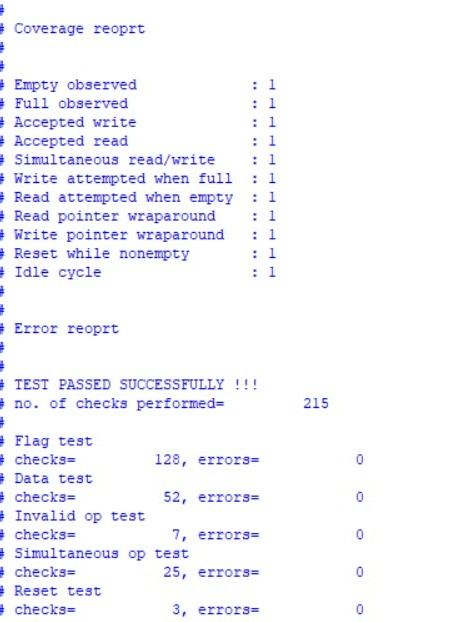

# Synchronous FIFO — Verilog RTL and Verification

## Overview

A synchronous First-In, First-Out (FIFO) buffer implemented in Verilog HDL, with multiple testbenches to explore functional verification techniques.

## Design Specifications

- Data width: 8 bits (default)
- FIFO depth: 8 entries (default)
- Synchronous read and write operations
- Circular read and write pointers
- Full and empty status flags
- Simultaneous read and write operations supported
- Extra bit in pointers used to detect a wraparound
- DATA_DEPTH values must be a power of 2

## Verification Approach

### 1. Directed Testing
Directed testing uses explicitly defined stimulus to exercise specific scenarios. The engineer identifies the scenarios to test and checks whether the DUT behaves as expected.

### 2. Scoreboard-Based Verification
The scoreboard introduces an independent reference model that receives the same stimulus as the DUT. It predicts the expected FIFO behavior and compares the expected results against the DUT's outputs, including read data and status flags. This makes the testbench self-checking and automates error detection. The testbench also maintains counters for different checks and errors and displays a summary at the end.

### 3. Randomized Parameterized Testing
The randomized testbench generates varied read/write stimulus and compares the DUT's behavior against the reference model. This helps explore sequences and interactions that may be difficult to enumerate manually, but it may not hit all cases. Functional coverage flags track whether selected important scenarios have occurred, helping identify gaps in the randomly tested scenarios. The testbench is parameterized to support different data widths and FIFO depths.

The project evolved incrementally: I began with directed testing to establish basic FIFO functionality, then developed a scoreboard-based testbench, and finally extended the verification approach with randomized stimulus and functional coverage.

## Repository Structure

- `fifo_implementation.v` — FIFO RTL implementation
- `tb_fifo.v` — directed testbench
- `tb_fifo_scoreboard.v` — self-checking scoreboard testbench
- `tb_fifo_random_parametrized.v` — randomized parameterized testbench

## Tools

- Verilog HDL
- Questa / ModelSim

## Simulation

Compile the RTL and the testbench you want to run in Questa/ModelSim. Use the following codes for the respective testbenches:

### 1. Directed Testbench

```tcl
vlib work
vlog rtl/fifo_implementation.v tb/tb_fifo.v
vsim -voptargs=+acc work.tb_fifo
add wave -r sim:/tb_fifo/*
run -all
```

### 2. Scoreboard-Based Testbench

```tcl
vlib work
vlog rtl/fifo_implementation.v tb/tb_fifo_scoreboard.v
vsim -voptargs=+acc work.tb_fifo_scoreboard
add wave -r sim:/tb_fifo_scoreboard/*
run -all
```

### 3. Randomized Parameterized Testbench

```tcl
vlib work
vlog rtl/fifo_implementation.v tb/tb_fifo_random_parametrized.v
vsim -voptargs=+acc work.tb_fifo_random_parametrized
add wave -r sim:/tb_fifo_random_parametrized/*
run -all
```
These codes enable signal access and also add all the internal waveform signals in the waveform viewer to enable waveform debugging. If the waveform window feels cluttered with signals, only keep the waveforms that you want to monitor and remove the others.

## Results

### 1. Basic FIFO Operations (Directed Testing)

The waveform demonstrates synchronous write and read transactions, showing that data is read in FIFO order and illustrating the behavior of the full and empty flags. The read and write pointers are changed as the data is read or written in the memory.



### 2. Signal Monitoring

The testbench monitors every signal of DUT each time an operation is performed to make debugging easier. This is practiced for all the three testbenches.



### 3. Directed Testing Sumary

The report summarises how many checks were done for each type of test, and how many errors were reported.



### 4. DUT and Model comparison (Scoreboard based Verification)

The waveform illustrates how the DUT operation compares to the operation of an independent reference model under the same stimulus. Scoreboard based verification is used to compare the DUT to the model and verify the DUT.



### 5. Scoreboard Summary

The scoreboard summary gives us the final verdict of the verification. It also shows how many total checks were performed and then shows how many checks were performed for each test and how many errors were reported.



### 5. Randomised and Parameterised Waveform

This waveform shows us the result of a randomised and parameterised FIFO. It shows the parameters- DATA_WIDTH, DATA_DEPTH, and POINTER_WIDTH on the top, followed by the DUT signals and the model signals. Randomised testing poses a challenge that we can't guarantee that all possible test cases are covered, so the coverage flags track whether the important cases are covered, thus we can test the FIFO for various random testcases, while also making sure that important testcases are covered.



### 5. Coverage and Error Report

This report summarises what all cases were covered in the randomised testing, to ensure that randomised testing doesn't miss important tests. The error report gives the verdict of the tests and shows how many checks were performed for each test and how many errors occurred in them.




## Future Improvements

- Additional corner-case testing
- Expanded functional coverage
- SystemVerilog-based verification
- Making randomised tests reproducible
